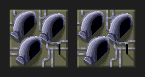

# Aperçu 1.0.542 — Windtrap Rebels, brouillon

66 images exportées du moteur, 16 images/seconde, boucle complète. Le bâtiment, ses couleurs de faction et ses phases sont conservés ; seule la couleur du cycle passe du bleu au vert. Référence : Rebels ArcaKev.

Proposition en cours de vérification : hors Vanilla, une amélioration par Windtrap standard, 150 crédits, technologie 7 et IX, production doublée. Cet aperçu ne publie aucune version du jeu. Aucun tag/release 1.0.542 n’est créé.
