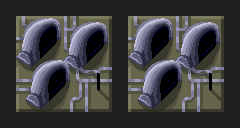

<!-- historical-546 -->
# Historique — aperçu Windtrap 542

**Statut revu pour la 1.0.546 (30 octobre 2026).** L’amélioration verte/double puissance Rebels a été livrée. Cet aperçu est une référence graphique historique. Les phrases de préparation, dates et numéros de protocole/sauvegarde ci-dessous sont conservés pour la traçabilité. Voir le [suivi actuel](../../docs/SUIVI-1.0.546-FR.md) pour les essais humains et avis des auteurs encore attendus.

---

# Aperçu 1.0.542 — Windtrap Rebels, brouillon

66 images exportées du moteur, 16 images/seconde, boucle complète. Le bâtiment, ses couleurs de faction et ses phases sont conservés ; seule la couleur du cycle passe du bleu au vert. Référence : Rebels ArcaKev.

Proposition en cours de vérification : hors Vanilla, une amélioration par Windtrap standard, 150 crédits, technologie 7 et IX, production doublée. Cet aperçu ne publie aucune version du jeu. Aucun tag/release 1.0.542 n’est créé.
